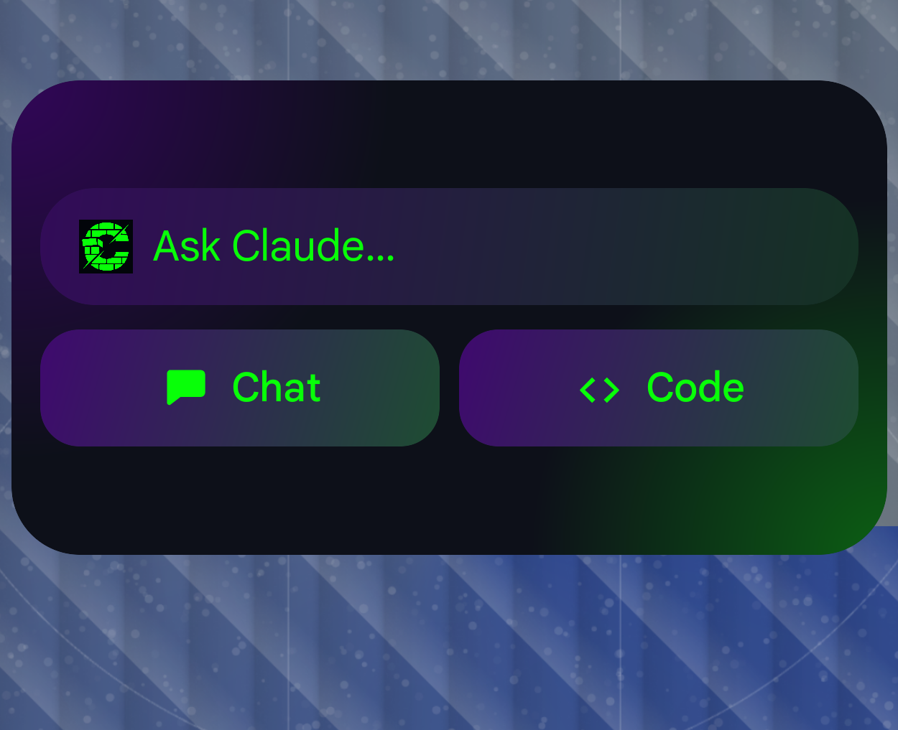

# Modern Claude Widget

[](https://github.com/clayboicardi/modern-claude-widget/actions/workflows/ci.yml)

A ChatGPT-style Android home-screen widget that deep-links straight into the [Claude](https://claude.ai) app. Two buttons — **Chat** and **Code** — plus an "Ask Claude…" pill that opens a fresh conversation. It's a pure deep-link launcher: **no backend, no API key, no `INTERNET` permission.**

> **Disclaimer — unofficial.** This is an independent, community project. It is **not affiliated with, endorsed by, or sponsored by Anthropic.** "Claude" is a trademark of Anthropic, PBC. All widget icons are original and do not reproduce Anthropic's (or any third party's) marks. The widget only launches the official Claude app through public deep links — it ships no Anthropic code, assets, or credentials.

## Screenshot



## What it does

| Tap | Opens |
|---|---|
| **Ask Claude…** pill | A new conversation composer (`claude://new`) |
| **Chat** | A new conversation composer (`claude://new`) |
| **Code** | The Code / Remote Control list (`claude://code`) |

If the Claude app isn't installed, the widget falls through to the Play Store listing.

The Code routes are [documented by Anthropic](https://support.claude.com/en/articles/14898120-open-the-claude-mobile-app-with-a-link) and need Claude Code access on your account. `claude://new` is not documented; it is kept because it is verified on-device (see [`docs/route-probe.md`](docs/route-probe.md)).

The official Claude app ships [its own widget](https://support.claude.com/en/articles/10534883-use-the-claude-widget-on-android) (new chat, camera, voice). This one exists for the one-tap **Code** entry and the look.

## How it works

The UI never hard-codes a single intent. Each button looks up a `Destination` in a small registry and walks an **ordered list of launch attempts**, stopping at the first that succeeds:

```
ViewUri(claude://…)  →  Claude app launcher  →  Play Store (market:// then https)
```

- Launches fire from an `actionRunCallback` (not `actionStartActivity`), keyed on a per-button parameter so each button keeps its own identity.
- Every `Intent` is built from the registry — a `Parcelable` intent is never forwarded from widget extras (intent-redirection hardening).
- Deep links are pinned to Claude's package, so another app that registers `claude://` can't intercept a tap.
- Unknown/missing actions **fail closed** to simply opening Claude, never crash.
- The app's own manifest requests no permissions. Glance's WorkManager dependency adds four ordinary ones (wake lock, network *state*, boot completed, foreground service), and AndroidX Core adds one private signature-level permission that only this app can hold. `INTERNET` is not among them, and a test fails the build if the set ever changes.
- Routes were validated on-device against the real Claude app; see [`docs/route-probe.md`](docs/route-probe.md).

## Build & run

**Requirements:** JDK 17+, Android SDK with **API 37** platform + **Build-Tools 37**, a device/emulator on Android 12+ (minSdk 31). The Gradle wrapper pins Gradle 9.9.2 (checksum-verified); the build uses AGP 9.5.2 and Kotlin 2.4.21.

**Android Studio:** open the project and let it sync. The app has no activity, so install it (`./gradlew installDebug`) rather than Run it. Then long-press the home screen → **Widgets** → **Claude Widget**.

**Command line:**
```bash
./gradlew lint test assembleDebug   # everything CI checks
./gradlew test                      # JVM unit tests only
./gradlew installDebug              # install to a connected device
```

## Good to know

- **After a force-stop the widget turns grey.** Android (15 and later) disables the widgets of a force-stopped app. Tap the grey widget once and it comes back; no need to re-add it.
- **Sizes.** Resizable from 2 cells wide (icons only) up to full width (icons + labels), 2 rows tall or more.

## Tech stack

- **Kotlin** + **Jetpack Glance** (`androidx.glance:glance-appwidget`) — Compose-style widgets rendered as RemoteViews.
- Single module, package `com.clayboicardi.claudewidget`.
- compileSdk / targetSdk **37** (Android 17), minSdk **31**.
- Tests: JUnit 4, Glance's unit-test harness, and Robolectric for the launch chain and the manifest contract.

## Design

The widget is rendered with Jetpack Glance, which is far more constrained than web/CSS. If you're iterating on the visual design, read [`DESIGN.md`](DESIGN.md) first — it documents what Glance can and can't render so designs stay buildable.

## Extending it

Adding a button is one `Destination` (an ordered attempt list) + a drawable + one `clickable`. The registry and launcher are already generic. Example hook: a prefilled Code task via `claude://code/new?q=<url-encoded>` (documented by Anthropic, with optional `mode`, `repo` and `branch`); `LaunchUri.build` already does the encoding.

Contributor and agent notes (exact commands, the on-device probe method, project boundaries) are in [`CLAUDE.md`](CLAUDE.md). The November 2026 audit, with open proposals, is in [`docs/audit-2026-11.md`](docs/audit-2026-11.md).
